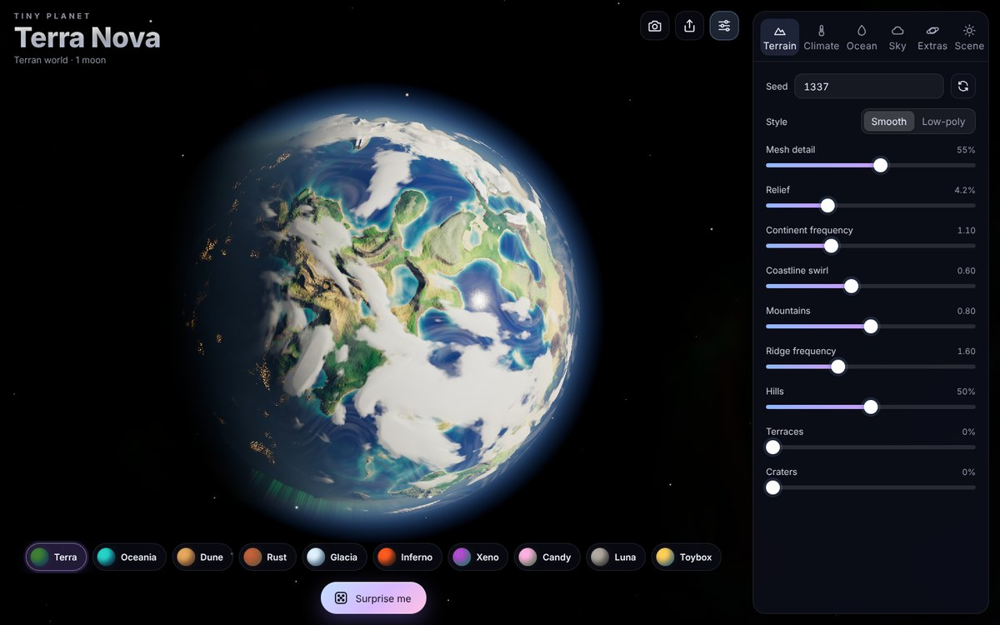
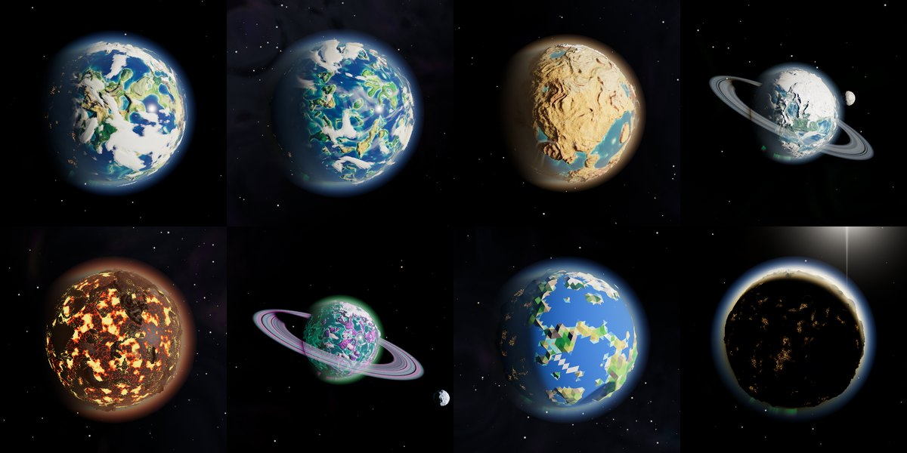

# Tiny Planet 🪐

A procedural generator for small, stylized 3D planets, built with TypeScript and Three.js.
Planets have biomes and climate, oceans (or lava), atmospheric scattering, layered clouds,
a day/night terminator with city lights, aurorae, rings and moons. It runs in the browser,
can be installed on a phone's home screen, and exports planets for use in games.

**Play:** https://lasseastrup.github.io/Tinyplanet/ (after GitHub Pages is enabled, see [Deploying](#deploying-to-github-pages))





## Features

**Terrain** (generated in a Web Worker, deterministic per seed)
- Geodesic icosphere mesh without seams: ~16k to ~360k vertices (smooth style), or a few thousand facets (low-poly)
- Domain-warped fBm continents, ridged mountain ranges, hills, optional terraces and craters
- Smooth or low-poly (flat-shaded, per-face colors) style
- Moons with craters and dark "maria"

**Climate & biomes**
- Temperature from latitude, altitude (lapse rate) and noise
- Moisture from noise, Hadley-cell latitude bands and distance to the coast (continental interiors are drier)
- Whittaker-style biome lookup: tundra, taiga, grassland, forest, jungle, savanna, desert, plus beaches,
  rocky slopes and ridges, snow caps and sea ice. All colors are editable.
- Sea level, temperature and humidity change instantly on the GPU, so you can flood a planet or
  start an ice age while dragging the slider

**Visual effects**
- Physically based single-scattering atmosphere (Rayleigh + Mie), ray-marched per pixel against the depth
  buffer: blue limb glow, haze, reddened light at the terminator, and sunsets seen through the limb
- Sunlight reaching the surface and clouds is filtered through the atmosphere, so the terminator turns warm
- Two cloud layers: procedural clouds with cyclone swirls, latitude bands and soft 3D shading,
  plus high cirrus. Clouds cast shadows on the ground.
- Ocean with depth-based color, transparent shallows, animated shoreline surf, a GGX sun glint, Fresnel sky
  reflection, sea ice and optional bioluminescence
- Lava oceans with drifting crust plates and glowing cracks
- City lights on the night side (only in habitable lowlands), aurorae around the poles
- Planetary rings with procedural bands and gaps, lit with forward scattering, with planet → ring and
  ring → planet shadows
- Moons that cast eclipse shadows on the planet and are lit by planetshine
- Starfield (with a galactic band), a seeded nebula sky, sun glare, HDR bloom, ACES tone mapping

**App**
- 10 curated presets: Terra, Oceania, Dune, Rust, Glacia, Inferno, Xeno, Candy, Luna, Toybox (low-poly).
  Tap the active preset again for a new variation, or press **Surprise me** for a random planet.
- Type a name into the title to seed a planet from that name
- Every planet is stored in the URL, so a link reproduces it exactly
- Screenshot, share link, export `.glb` and `.json`
- Phone-friendly UI (bottom sheet, safe areas, touch controls), adaptive resolution, quality levels
- Installable PWA that works offline

## Add it to your home screen

- **iPhone / iPad (Safari):** open the site, tap **Share** → **Add to Home Screen**.
- **Android (Chrome):** open the site, tap **⋮** → **Install app** (or **Add to Home screen**).

It then launches like a native app without browser bars, works offline after the first visit, and reopens the last planet you made.

## Controls

| Action | Mouse / keyboard | Touch |
| --- | --- | --- |
| Rotate | drag | one-finger drag |
| Zoom | scroll | pinch |
| Random planet | `R` / **Surprise me** | **Surprise me** |
| Hide the interface | `H` | Scene tab → **Hide interface** |
| Close the panel | `Esc` | drag the sheet handle down |
| Reset a slider to the preset value | double-click its label | |

## Using planets in a game

### 1. Export a model (`.glb`)

In the **Scene** tab pick an **Export detail** level and press **Export .glb**. The file is a plain glTF 2.0
scene that loads in Three.js, Babylon.js, Godot, Unity (glTFast), Unreal, Blender and others:

- `Terrain`: mesh with biome colors baked into vertex colors (`COLOR_0`)
- `Ocean`: semi-transparent water shell (vertex alpha by depth) or an emissive lava shell
- `Rings`: unlit textured ring (if enabled)
- `Moon1..n`: moons at their current orbital positions
- The full parameter set is stored in the root node's `extras.params`

Atmosphere, clouds and other shader effects aren't part of the export. Use the live renderer (option 3)
if you need them.

### 2. Export the settings (`.json`)

**Export settings** saves the parameters. Generation is deterministic, so the same parameters always
produce the same planet. You can regenerate it at runtime at any resolution.

### 3. Use the generator and renderer directly (Three.js)

The code is split so the generator and the renderer can be dropped into another project:

```ts
import * as THREE from 'three';
import { generateTerrain, generateMoons } from './planet/generator';
import { getPreset } from './planet/presets';
import { shapeParamsOf } from './planet/params';
import { PlanetView } from './render/PlanetView';
import { qualitySettings } from './render/quality';

const params = getPreset('oceania')!.params; // or JSON.parse(exportedJson).params
const shape = shapeParamsOf(params, 120);    // 120 = max mesh frequency

const planet = new PlanetView(qualitySettings('medium').defines);
planet.applyParams(params);
planet.setTerrain(generateTerrain(shape), shape.heightScale, shape.lowPoly);
planet.setMoons(generateMoons(shape.seed, shape.moons, shape.lowPoly), shape.lowPoly);
scene.add(planet.root);

renderer.toneMapping = THREE.ACESFilmicToneMapping;
// every frame:
planet.update(elapsedSeconds, deltaSeconds);
```

The planet materials tone-map correctly when rendered straight to the screen. For the atmosphere,
bloom and final grade, render through `PostFX` (see `src/render/PostFX.ts` and how `src/app/App.ts` uses it).

`generateTerrain` returns plain typed arrays: positions, normals, per-vertex data
(`height, temperature, moisture, rockiness`) and indices. It has no DOM or Three.js dependency, so you can
also use it for collision meshes, object placement (trees in forests, cities on coasts) or server-side generation.
`src/planet/colors.ts` turns that data into biome colors.

## Development

Requires Node 20.19+ or 22.12+.

```bash
npm install
npm run dev        # dev server at http://localhost:5173 (also reachable on your LAN for phone testing)
npm run build      # type-check + production build into dist/
npm run preview    # serve the production build
```

Useful URL parameters: `?preset=glacia`, `?quality=low|medium|high`.

## Deploying to GitHub Pages

The workflow in `.github/workflows/deploy.yml` builds and deploys the site on every push to `main`.
You need to enable Pages once:

1. Open the repository on GitHub → **Settings** → **Pages**.
2. Under **Build and deployment**, set **Source** to **GitHub Actions**.
3. Re-run the **Deploy to GitHub Pages** workflow from the **Actions** tab, or push a commit.

The site will be at `https://<user>.github.io/<repo>/`. The build uses relative paths, so it works under
any repository name or a custom domain.

## Project structure

```
src/
  app/App.ts              renderer, camera, controls, render loop, regeneration scheduling
  core/                   seeded RNG, simplex noise, math helpers
  planet/
    params.ts             all parameters, ranges and sanitising
    generator.ts          terrain + moon generation (pure TS, runs in the worker)
    icosphere.ts          seamless geodesic sphere
    worker.ts / GeneratorClient.ts   Web Worker + request coalescing
    biomes.ts / colors.ts biome lookup table and CPU color baking
    presets.ts / randomize.ts / names.ts / share.ts
  render/
    PlanetView.ts         Three.js scene graph and uniforms for one planet
    materials/            terrain, ocean, clouds, rings, aurora shaders
    shaders/              shared GLSL (noise, scattering, shadows)
    PostFX.ts             atmosphere pass, bloom, tone mapping
    SpaceBackground.ts    stars, nebula, sun
  ui/                     panel, controls schema, icons, styles
  export/                 glTF export and file delivery
```

## Credits

- 3D simplex noise in GLSL: [webgl-noise](https://github.com/ashima/webgl-noise) by Ashima Arts and Stefan Gustavson (MIT)
- CPU simplex noise based on Stefan Gustavson's public-domain reference implementation
- Built with [Three.js](https://threejs.org) and [Vite](https://vite.dev)
